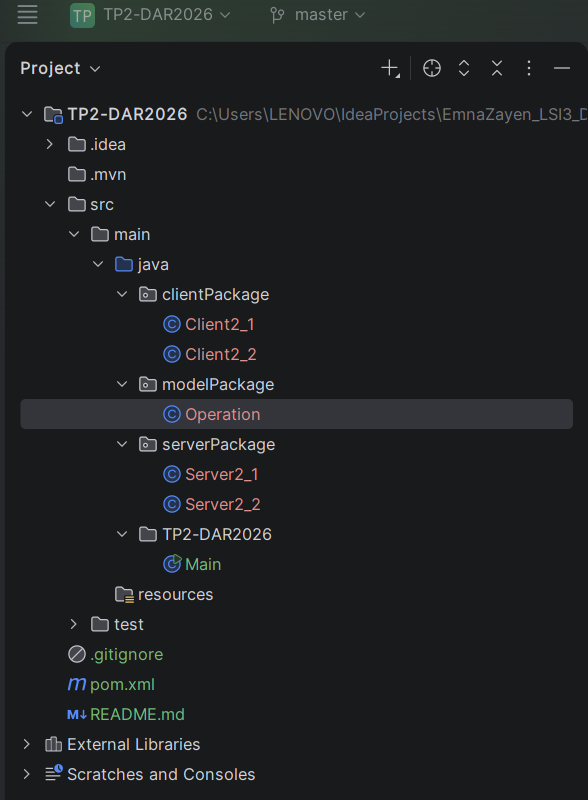
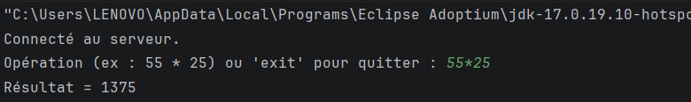
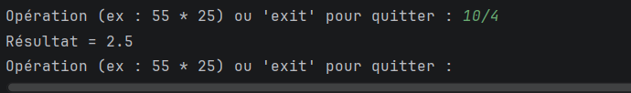
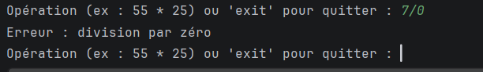
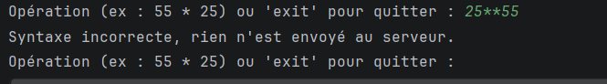
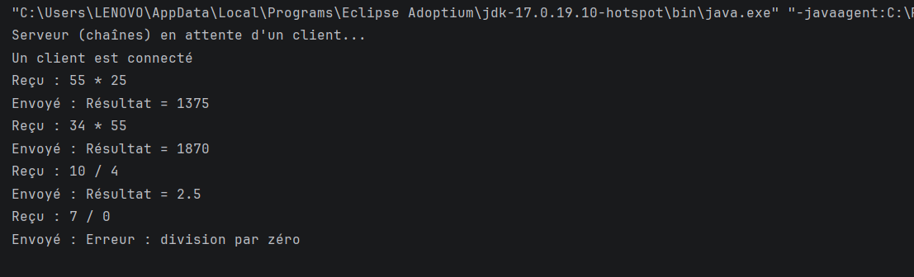
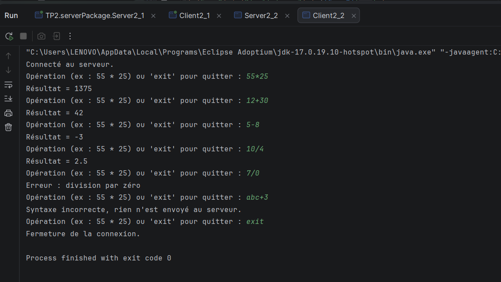
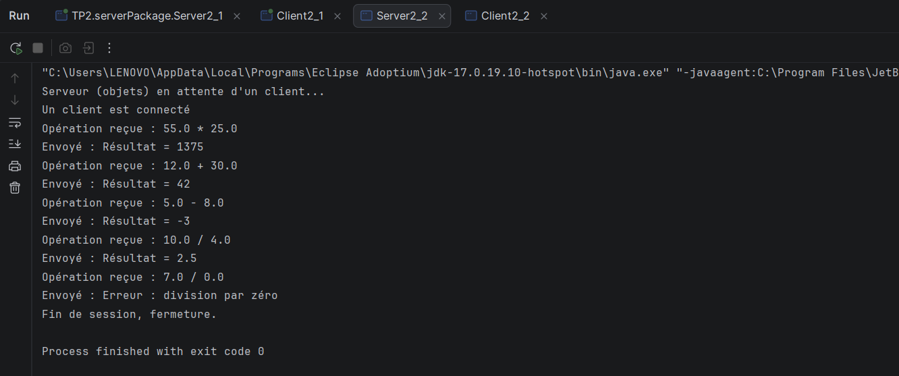

# TP2-DAR2026 : Les sockets en mode connecté TCP, E/R de chaînes de caractères et d'objets

---

## Activité 2-1 : Échange de chaînes de caractères

**Objectif :** permettre au client d'envoyer une **opération complète** (par exemple `55 * 25`) et non plus un seul entier. Le client envoie les trois éléments de l'opération (premier opérande, opérateur, deuxième opérande), le serveur calcule et renvoie le résultat.


### Étape 1 : Préparation de l'espace de travail




### Étape 2 : Application des flux de traitement de chaînes de caractères

**Flux utilisés :**
- `InputStreamReader` convertit les octets reçus en caractères ;
- `BufferedReader` ajoute un tampon et la méthode `readLine()` qui lit une ligne complète ;
- `PrintWriter` (avec l'option `autoFlush` à `true`) écrit des chaînes avec `println()` et les envoie immédiatement.

**Protocole d'échange :** chaque information est envoyée sur **une ligne**.


**Validation côté client :** avant tout envoi, l'opération saisie est contrôlée avec une expression régulière. Les chaînes incorrectes comme `25 ** 55` ou `abc + 3` sont refusées et ne sont jamais envoyées au serveur.

Serveur 

```java
package TP2.serverPackage;

import java.io.BufferedReader;
import java.io.IOException;
import java.io.InputStream;
import java.io.InputStreamReader;
import java.io.OutputStream;
import java.io.PrintWriter;
import java.net.ServerSocket;
import java.net.Socket;

public class Server2_1 {

    public static void main(String[] args) {
        try {
            ServerSocket serverSocket = new ServerSocket(1234);
            System.out.println("Je suis un serveur en attente la connexion d'un client ");
            Socket socket = serverSocket.accept();
            System.out.println("un client est connecté");

            InputStream is = socket.getInputStream();
            BufferedReader br = new BufferedReader(new InputStreamReader(is));
            OutputStream os = socket.getOutputStream();
            PrintWriter pw = new PrintWriter(os, true);

            String operande1 = br.readLine();
            while (operande1 != null && !operande1.equals("quit")) {
                String operateur = br.readLine();
                String operande2 = br.readLine();
                System.out.println("Opération reçue : " + operande1 + " " + operateur + " " + operande2);

                String reponse;
                try {
                    reponse = calculer(Double.parseDouble(operande1), operateur,
                            Double.parseDouble(operande2));
                } catch (NumberFormatException e) {
                    reponse = "Erreur : opérande invalide";
                }

                pw.println(reponse);
                System.out.println("Réponse envoyée : " + reponse);

                operande1 = br.readLine(); 
            }

            System.out.println("Fin de la communication");
            socket.close();
            serverSocket.close();
        } catch (IOException e) {
            System.out.println("Erreur côté serveur : " + e.getMessage());
        }
    }

    static String calculer(double a, String operateur, double b) {
        double r;
        switch (operateur) {
            case "+": r = a + b; break;
            case "-": r = a - b; break;
            case "*": r = a * b; break;
            case "/":
                if (b == 0) {
                    return "Erreur : division par zéro impossible";
                }
                r = a / b;
                break;
            default:
                return "Erreur : opérateur inconnu";
        }
        return a + " " + operateur + " " + b + " = " + r;
    }

    static String formater(double v) {
        if (v == Math.rint(v) && !Double.isInfinite(v)) {
            return String.valueOf((long) v);
        }
        return String.valueOf(v);
    }
}
```

**Client (`clientPackage/Client2_1.java`) :**

```java
package TP2.clientPackage;

import java.io.BufferedReader;
import java.io.IOException;
import java.io.InputStreamReader;
import java.io.PrintWriter;
import java.net.Socket;
import java.util.Scanner;
import java.util.regex.Matcher;
import java.util.regex.Pattern;

public class Client2_1 {

    static final Pattern SYNTAXE = Pattern.compile(
            "^\\s*(-?\\d+(?:\\.\\d+)?)\\s*([+\\-*/])\\s*(-?\\d+(?:\\.\\d+)?)\\s*$");

    public static void main(String[] args) {
        try {
            System.out.println("Je suis un client pas encore connecté…");
            Socket socket = new Socket("localhost", 1234);
            System.out.println("je suis un client connecté");

            PrintWriter pw = new PrintWriter(socket.getOutputStream(), true);
            BufferedReader br = new BufferedReader(
                    new InputStreamReader(socket.getInputStream()));
            Scanner sc = new Scanner(System.in);

            while (true) {
                System.out.print("Donnez une opération (ex : 55 * 25) ou quit : ");
                String saisie = sc.nextLine().trim();
                if (saisie.equals("quit")) {
                    break;
                }

                Matcher m = SYNTAXE.matcher(saisie);
                if (!m.matches()) {
                    System.out.println("Syntaxe invalide, rien n'est envoyé.");
                    continue;
                }
                
                pw.println(m.group(1)); 
                pw.println(m.group(2)); 
                pw.println(m.group(3)); 

                
                String reponse = br.readLine();
                System.out.println("Résultat : " + reponse);
            }

            pw.println("quit"); 
            System.out.println("Fin de la communication");
            sc.close();
            socket.close();
        } catch (IOException e) {
            System.out.println("Erreur côté client : " + e.getMessage());
        }
    }
}


```

**Explications :**
- `readLine()` est bloquant : il attend un caractère de fin de ligne. C'est `println()` qui l'envoie, ce qui délimite chaque information.
- `new PrintWriter(..., true)` active l'envoi automatique après chaque `println()`. Sans lui, il faudrait appeler `flush()` à chaque fois, sinon le serveur attendrait indéfiniment.
- Le serveur vérifie aussi les opérandes (`NumberFormatException`), car il ne doit jamais faire confiance au client.

### Tests

| Saisie | Résultat attendu | Capture |
|---|---|---|
| `55 * 25` | `Résultat = 1375` |  |
| `10 / 4` | `Résultat = 2.5` |  |
| `7 / 0` | `Erreur : division par zéro` |  |
| `25 ** 55` | refusé côté client |  |




**Description :** *(Le client envoie les trois éléments de l'opération, le serveur calcule et renvoie le résultat. Les chaînes incorrectes sont bloquées par la validation côté client et ne parviennent jamais au serveur. La division par zéro est gérée côté serveur par un message d'erreur.)*


## Activité 2-2 : Échange d'objets

**Objectif :** échanger des **objets Java** entre le client et le serveur grâce à la **sérialisation** et à l'interface `Serializable`.

### Notion de sérialisation

La sérialisation transforme un objet en une suite d'octets pour le transmettre sur le réseau. La **désérialisation** reconstruit l'objet de l'autre côté. Pour qu'un objet soit sérialisable, sa classe doit implémenter l'interface `Serializable`, qui est une interface sans méthode : elle sert uniquement de marqueur. Tous les attributs doivent eux-mêmes être sérialisables, sauf ceux déclarés `transient`.

**Description :** *(le package `modelPackage` contient la classe partagée `Operation`, utilisée à la fois par le client et par le serveur.)*

### Étape 2 : Implémentation de l'échange d'objets

**Classe sérialisable  :**

```java
package modelPackage;

import java.io.Serializable;
public class Operation implements Serializable {

    private static final long serialVersionUID = 1L;

    private double operande1;
    private char operateur;
    private double operande2;

    public Operation(double operande1, char operateur, double operande2) {
        this.operande1 = operande1;
        this.operateur = operateur;
        this.operande2 = operande2;
    }

    public double getOperande1() { return operande1; }
    public char getOperateur()   { return operateur; }
    public double getOperande2() { return operande2; }

    @Override
    public String toString() {
        return operande1 + " " + operateur + " " + operande2;
    }
}
```

**Serveur :**

```java
package TP2.serverPackage;

import TP2.modelPackage.Operation;

import java.io.EOFException;
import java.io.IOException;
import java.io.ObjectInputStream;
import java.io.ObjectOutputStream;
import java.net.ServerSocket;
import java.net.Socket;

public class Server2_2 {

    public static void main(String[] args) {
        try (ServerSocket serverSocket = new ServerSocket(1235)) {
            System.out.println("Serveur (objets) en attente d'un client...");
            Socket socket = serverSocket.accept();
            System.out.println("Un client est connecté");

            ObjectOutputStream out = new ObjectOutputStream(socket.getOutputStream());
            out.flush();
            ObjectInputStream in = new ObjectInputStream(socket.getInputStream());

            while (true) {
                Object recu = in.readObject();
                if (recu instanceof String && recu.equals("FIN")) {
                    break;
                }
                Operation op = (Operation) recu;                 
                System.out.println("Opération reçue : " + op);

                String resultat = calculer(op);                  
                out.writeObject(resultat);                       
                out.flush();
                System.out.println("Envoyé : " + resultat);
            }

            System.out.println("Fin de session, fermeture.");
            in.close();
            out.close();
            socket.close();

        } catch (EOFException e) {
            System.out.println("Le client s'est déconnecté brutalement.");
        } catch (IOException | ClassNotFoundException e) {
            e.printStackTrace();
        }
    }

    private static String calculer(Operation op) {
        double a = op.getOperande1();
        double b = op.getOperande2();
        double r;
        switch (op.getOperateur()) {
            case '+':
                r = a + b;
                break;
            case '-':
                r = a - b;
                break;
            case '*':
                r = a * b;
                break;
            case '/':
                if (b == 0) return "Erreur : division par zéro";
                r = a / b;
                break;
            default:
                return "Erreur : opérateur inconnu";
        }
        return "Résultat = " + formater(r);
    }

    private static String formater(double r) {
        if (r == Math.rint(r) && Math.abs(r) < 1e15) {
            return String.valueOf((long) r);
        }
        return String.valueOf(r);
    }
}

```

**Client :**

```java
package TP2.clientPackage;

import TP2.modelPackage.Operation;

import java.io.IOException;
import java.io.ObjectInputStream;
import java.io.ObjectOutputStream;
import java.net.Socket;
import java.util.Scanner;
import java.util.regex.Matcher;
import java.util.regex.Pattern;

public class Client2_2 {

    private static final Pattern OPERATION = Pattern.compile(
            "^(-?\\d+(?:\\.\\d+)?)\\s*([+\\-*/])\\s*(-?\\d+(?:\\.\\d+)?)$");

    public static void main(String[] args) {
        try (Socket socket = new Socket("localhost", 1235);
             Scanner sc = new Scanner(System.in)) {

            System.out.println("Connecté au serveur.");
            
            ObjectOutputStream out = new ObjectOutputStream(socket.getOutputStream());
            out.flush();
            ObjectInputStream in = new ObjectInputStream(socket.getInputStream());

            while (true) {
                System.out.print("Opération (ex : 55 * 25) ou 'exit' pour quitter : ");
                String ligne = sc.nextLine().trim();

                if (ligne.equalsIgnoreCase("exit")) {
                    out.writeObject("FIN");
                    out.flush();
                    break;
                }

                Matcher m = OPERATION.matcher(ligne);
                if (!m.matches()) {
                    System.out.println("Syntaxe incorrecte, rien n'est envoyé au serveur.");
                    continue;
                }

                Operation op = new Operation(
                        Double.parseDouble(m.group(1)),
                        m.group(2).charAt(0),
                        Double.parseDouble(m.group(3)));

                out.writeObject(op);
                out.flush();

                String resultat = (String) in.readObject();      
                System.out.println(resultat);
            }

            System.out.println("Fermeture de la connexion.");

        } catch (IOException | ClassNotFoundException e) {
            e.printStackTrace();
        }
    }
}

```

**Explications :**
- **Classe partagée :** `Operation` est dans un package commun, car le client et le serveur doivent connaître **exactement la même classe** (même nom complet, même `serialVersionUID`). Sinon `readObject()` lève une `ClassNotFoundException` ou une `InvalidClassException`.
- **Ordre de création des flux :** le constructeur de `ObjectOutputStream` écrit un en-tête, et celui de `ObjectInputStream` **attend** cet en-tête. Si les deux côtés créaient d'abord leur `ObjectInputStream`, chacun attendrait l'autre et le programme serait bloqué (interblocage). On crée donc toujours `ObjectOutputStream` en premier, puis `flush()`, puis `ObjectInputStream`.
- **`readObject()` retourne un `Object` :** il faut le convertir (`cast`) vers le bon type, d'où le test `instanceof` pour distinguer le message `"FIN"` d'une `Operation`.
- **Nouvel objet à chaque envoi :** `ObjectOutputStream` garde en mémoire les objets déjà envoyés. Renvoyer le même objet modifié enverrait l'ancienne version. On crée donc un nouvel objet à chaque tour (ou on appelle `out.reset()`).

### Tests




**Interprétation :** *(Le client crée un objet `Operation` contenant les deux opérandes et l'opérateur, puis l'envoie avec `writeObject()`. Le serveur le reçoit avec `readObject()`, lit ses attributs, effectue le calcul et renvoie le résultat. L'échange d'objets remplace l'envoi séparé de trois chaînes de l'activité 2-1.)*
